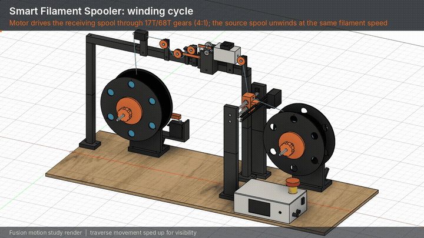

# Open-Source Smart Filament Spooler

A bench machine that rewinds 3D printer filament from one spool onto another under controlled tension, measures how much has gone across, and can join a second spool on with a filament connector. It is my BEng Individual Project at King's College London (2026–27), designed around PLA and a £100 parts budget, with all structural parts 3D printed.

## How it works

- A NEMA 17 stepper drives the receiving spool through printed 17T/68T gears (4:1).
- The source spool is pulled round by the filament. A servo-operated brake on it sets the back tension.
- A spring-loaded dancer arm with a potentiometer measures the tension, and a PID loop on the brake holds it at 5 N.
- A measuring wheel read by an AS5600 magnetic encoder gives the length transferred. A hall sensor on the source spool and the motor step count cross-check it, so slip shows up when they stop agreeing.
- A belt-driven traverse lays the filament across the receiving spool in even rows.
- A runout switch and the shrinking source spool radius warn the controller that the spool is ending. In splice mode the tail is parked at a clamp and the next spool is joined on with a SUNLU FC01 connector.
- An ESP32-S3 with a 2.8 in touchscreen runs it all.

## Repository layout

| Folder | What is in it |
| --- | --- |
| `cad/fusion-scripts` | Fusion 360 Python scripts. `SpoolerAssembly.py` builds the whole assembly from the parameters at its top; `SpoolerMotion.py` adds the motion links and checks the gear mesh; `SpoolerRecord.py` records animation frames; `SpoolerTensionModel.py` runs the tension model inside Fusion's Python. |
| `cad/archive` | Earlier versions of the assembly and layout scripts. |
| `cad/drawings` | Assembly drawings (to be added). |
| `simulation` | Tension control model: MATLAB/Simulink, a plain MATLAB script version, and a Python cross-check. See its README. |
| `analysis` | Engineering and heat checks (bearing loads, gear strength, motor torque, heater and housing temperatures). |
| `firmware` | ESP32-S3 firmware (to be written). |
| `electronics` | Wiring and pin plan (to be added). |
| `media` | Animation of the machine running and the script that builds it. |
| `docs` | System flow diagram. |

## Running the CAD scripts

In Fusion 360, open Utilities → Scripts and Add-ins, add `cad/fusion-scripts/SpoolerAssembly.py` as a script and run it. With a spooler design already open, it rebuilds only the components listed in `UPDATE_ONLY`; set that list to `[]` for a full rebuild.

## Status

Design and modelling stage. CAD assembly, motion study, tension model and engineering checks are done; parts ordering, printing and firmware come next.
